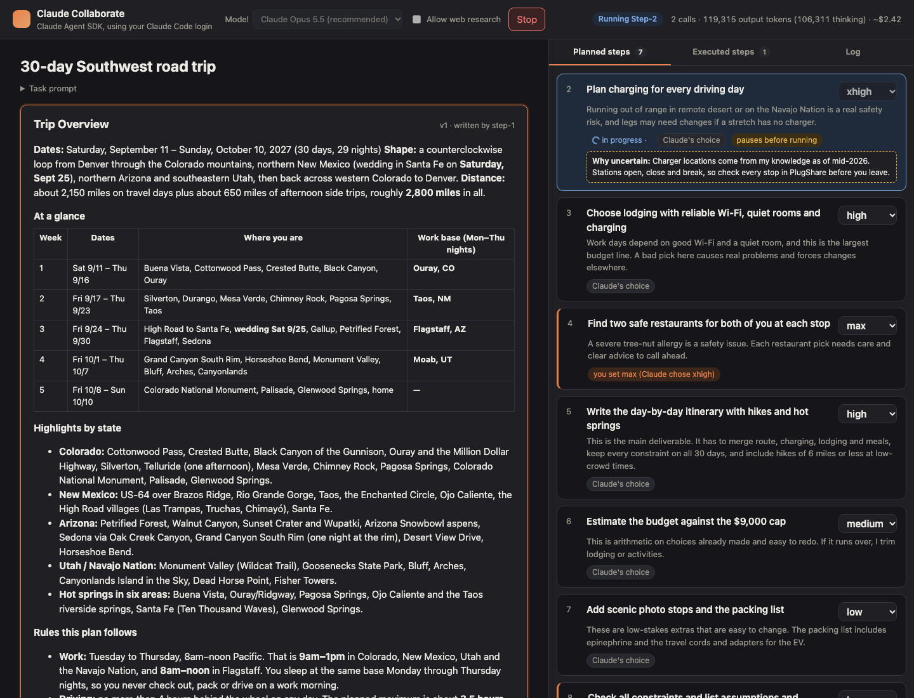
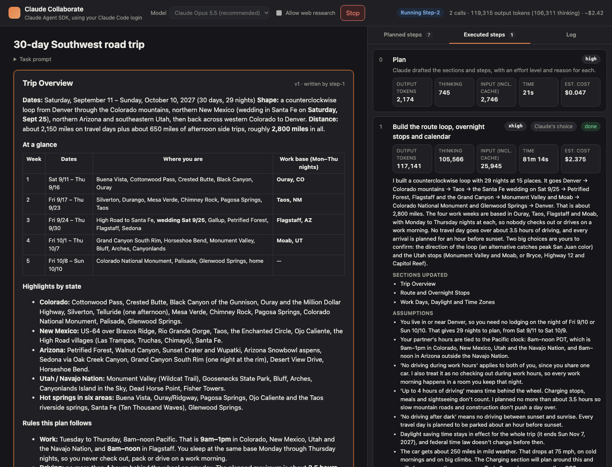

# Claude Collaborate

A working prototype of the product in [PRODUCT_PROPOSAL.md](PRODUCT_PROPOSAL.md): steer a long Claude task while it runs, with an **effort dial on every step**. Claude plans the task as steps and picks an effort level for each. You can change any level before the step starts, and the app sends that level to Claude for real. The capability bet behind it is in [CAPABILITY_PREDICTION.md](CAPABILITY_PREDICTION.md).

Every run makes live model calls. There is no mock mode and no canned output.





## Requirements

- Node 20 or newer
- One of:
  - **SDK mode (default):** Claude Code installed and signed in with a Claude Pro or Max subscription
  - **API mode:** an Anthropic API key
- macOS, Linux or Windows. The run-length notes below assume a laptop; keep it awake during a run.

## Quick start: SDK mode (subscription)

SDK mode runs Claude through the Claude Agent SDK, which uses the Claude Code engine on your machine and whatever account it is signed in with.

1. Install and sign in to Claude Code if you have not already:

   ```bash
   npm install -g @anthropic-ai/claude-code
   claude               # follow the login prompt, then quit
   claude auth status   # should show "loggedIn": true
   ```

2. Install and start the app:

   ```bash
   git clone <this repo> && cd antlabs-dynamic-compute
   npm install
   npm start
   ```

3. Open <http://localhost:4310>.

Optional: `npm run doctor` makes two tiny calls on your login and prints the effort and token counts, to confirm the setup before a full run.

Note on policy: Anthropic's docs say third-party developers may not offer claude.ai login in their products without approval. This is a local tool each person runs under their own existing login, not a product that offers login. Check with Anthropic before distributing it widely.

## Quick start: API mode (API key)

There are two ways to use a key.

**Key through the SDK (tested).** Keep the default mode and set the key. The Agent SDK prefers an API key over a subscription login, so the same code path runs and is billed to the key.

```bash
cp .env.example .env
# in .env:
ANTHROPIC_API_KEY=sk-ant-...
npm start
```

**Direct Messages API (untested).** This mode talks to the Messages API with no Claude Code in the loop and uses the per-message effort beta, which changes effort between turns without invalidating the prompt cache. It was written from the API reference without a key to test against, so expect small fixes.

```bash
# in .env:
COLLABORATE_PROVIDER=api
ANTHROPIC_API_KEY=sk-ant-...
npm start
```

The header of the page says which mode is active.

## Configuration

Copy `.env.example` to `.env`. All settings are optional.

| Variable | Default | What it does |
| --- | --- | --- |
| `COLLABORATE_PROVIDER` | `sdk` | `sdk`: Claude Agent SDK with your Claude Code login (or a key, if set). `api`: direct Messages API, needs a key. |
| `ANTHROPIC_API_KEY` | unset | Required for `api`. In `sdk` mode it switches billing from the subscription to the key. |
| `COLLABORATE_MODEL` | `claude-opus-5-5` | Default model in the UI. Opus 5.5, Sonnet 5.5 and Fable 5.1 all support the five effort levels. |
| `COLLABORATE_PAUSE_MS` | `10000` | Length of the pause after the plan and before uncertain steps. |
| `PORT` | `4310` | Port for the local web app. |

## Using the demo

1. **Prompt.** The task prompt box is pre-filled with the road trip scenario from the proposal. Edit it, replace it, or use one of the prompts in [prompt_examples](prompt_examples). "Reset to example" restores the default. Prompts are capped at 20,000 characters.
2. **Model and web research.** Pick a model in the header. "Allow web research" lets Claude use web search and fetch during steps. It is off by default because it makes steps several times slower; without it, facts come from the model's knowledge.
3. **Start run.** Claude plans the task at high effort: a document title, an outline, and the steps, each with an effort level (`low`, `medium`, `high`, `xhigh`, `max`), a one-line reason, and an "uncertain" flag.
4. **Plan pause.** The run pauses for 10 seconds. Change any step's effort in the Planned steps tab, extend the pause, or continue now. You can also change the effort on any unstarted step at any point during the run.
5. **Steps.** Each step is one message to Claude in the same conversation, sent at the step's current effort: yours if you set one, otherwise Claude's. The in-progress step is locked and shows a timer. The document fills in as steps finish.
6. **Uncertain steps.** Before a step Claude flagged as uncertain, the run pauses again and shows Claude's reason.
7. **Plan changes.** After a step, Claude can add steps or change the effort of later steps, with a reason. Each change is marked on the step card. A level you set is never overwritten: Claude's proposal is recorded as "kept your choice" and Claude is told on its next message.
8. **Executed steps.** One card per finished step: effort used and who chose it, output and thinking tokens, input tokens including cache, time, estimated cost, web calls, the summary, sections written, assumptions, decisions to confirm, and plan changes. Steps are listed in order, plan first.
9. **Document.** Each section keeps every version. An edited section shows changes against the previous version (added blocks green, removed blocks red). A section that was rewritten almost entirely shows clean, labelled "rewritten", with a "show changes" toggle.
10. **Stop.** Ends the run. The step in progress is marked "stopped" in the Executed tab.

Every run is saved as JSON under `runs/` for audit.

## What a run looks like

First full run: Opus 5.5, web research off, two overrides made during the plan pause. Output tokens include thinking.

| Step | Effort | Chosen by | Output tokens | Thinking | Time |
| --- | --- | --- | --- | --- | --- |
| Plan | high | app | 2,174 | 745 | 21s |
| 1. Route loop, overnight stops, calendar | xhigh | Claude | 117,141\* | 105,566\* | 81m\* |
| 2. Charging for every driving day | xhigh | Claude | 42,829 | 34,133 | 6m 51s |
| 3. Lodging with Wi-Fi and charging | high | Claude | 13,572 | 6,887 | 2m 12s |
| 4. Two safe restaurants per stop | **max** | **user** (Claude chose xhigh) | 65,748 | 55,082 | 10m 32s |
| 5. Day-by-day itinerary | high | Claude | 15,290 | 5,761 | 2m 14s |
| 6. Budget against the $9,000 cap | high | Claude, raised from medium after step 3 | 6,510 | 2,944 | 1m 2s |
| 7. Photo stops and packing list | low | Claude | 1,607 | 0 | 16s |
| 8. Constraint check, assumptions, decisions | **low** | **user** (Claude chose high) | 3,750 | 156 | 32s |

\* Inflated: the laptop slept during this step and each reconnect restarted the generation. See Troubleshooting.

Three things to point at: the effort gradient is real (low steps used under 4,000 output tokens and almost no thinking, xhigh steps used tens of thousands); overrides are honored (steps 4 and 8 ran at the user's level and say so); and Claude edited its own plan, raising the budget step after pricing lodging, with the reason "Lodging alone is about $5,760, leaving roughly $3,240 for 30 days of food plus activities. The budget step will likely have to make real trade-offs, not just add things up."

A full run of the road trip prompt takes 25 to 40 minutes with the machine awake. The xhigh and max steps are most of that. Shorter prompts finish in a few minutes.

## How it works

- **One conversation per run, one message per step.** The plan is the first message. Each step resumes the same conversation at its own effort level, so later steps see earlier results without re-sending the document.
- **Effort is a real inference parameter.** In SDK mode each step is a `query()` call with `resume` and `effort`. The level on a resumed call wins over the session's original level; this was tested before building (a low session resumed at max produced more output tokens than a max session resumed at low). Claude is never told which level it is running at.
- **Structured output.** The plan and every step come back as JSON against a schema: section updates in full Markdown, assumptions, decisions, new steps, and effort changes for later steps.
- **The user's choice holds.** A step with a user-set effort ignores Claude's proposed change; the proposal is still recorded and shown.
- **Tokens and cost** come from the per-call usage report. Thinking tokens are broken out in SDK mode; the direct API does not report them separately. Cost is the SDK's client-side estimate.
- **Claude Code settings are isolated.** The SDK runs with no setting sources, so a personal effort default or CLAUDE.md cannot leak in, and `CLAUDE_CODE_EFFORT_LEVEL` is removed from the environment because it would override per-step effort.
- **Keeping the machine awake.** On macOS the server runs `caffeinate -i -s` while a run is active. That blocks idle and system sleep on AC power but not a closed lid.

## Limitations

- Claude chooses each level but the app applies it between messages. Effort switching inside one agent turn is the capability being predicted, not demonstrated.
- Steps are coarser than those inside a real agent turn.
- Without web research, facts such as charger locations come from the model's knowledge and may be out of date.
- A plan with fewer than three steps shows a hint: short tasks are outside the product's target, and the effort dial reads best on longer ones.
- Saved runs cannot be loaded back into the UI.
- The direct API mode is untested.

## Troubleshooting

- **"Address already in use" on start.** Another copy is running on the port. Stop it with `kill $(lsof -ti:4310)` or set `PORT` in `.env`.
- **Run fails immediately in SDK mode.** Run `claude auth status`. If it is not logged in, run `claude` and sign in. Make sure `ANTHROPIC_API_KEY` is not set unless you mean to bill a key.
- **A step runs far longer than expected, and the Log shows "Connection problem, Claude Code is retrying".** The machine slept or lost its network. Claude Code reconnects, but the step restarts from scratch and the step's token count includes the abandoned attempts. Keep the laptop awake with the lid open during a run.
- **The page looks stale after editing the code.** The server does not reload code. Restart `npm start`. The browser never caches the UI files.
- **A step shows "failed".** The error text is on the card and in the Log. Start a new run; the plan is not reusable.

## Project layout

```
src/server.ts            Express server: static UI, event stream, action routes
src/orchestrator.ts      The run: plan, pauses, steps, plan changes, document versions
src/prompts.ts           Example prompt, system prompt, JSON schemas, per-step prompt
src/providers/agentSdk.ts    SDK mode (Claude Code login or API key)
src/providers/messagesApi.ts API mode (Messages API, per-message effort beta)
src/doctor.ts            Setup check: two small calls at low and max effort
public/                  Browser UI, no build step
prompt_examples/         More long-task prompts to try
docs/                    Screenshots
runs/                    Saved run state, one JSON per run (gitignored)
```
